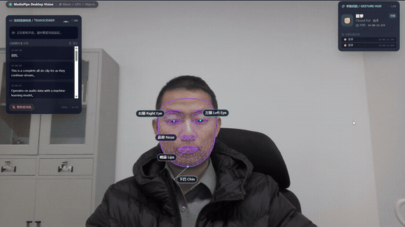

# 🌟 MediaPipe Desktop Vision

<div align="center">


<p align="center">
  <b>基于 Tauri 2 + Google MediaPipe + Ultralytics YOLO-World 开发的下一代桌面级多模态 AI 视觉感知与交互应用</b><br>
  集成了手势骨骼、面部 3D 网格、五官气泡、开放词表日常物品识别（YOLO-World / MediaPipe）、手势分类 HUD 与实时语音转写。
</p>

<!-- 演示视频预览播放与动效 -->
<p align="center">
  <video src="https://github.com/lz-kwok/mediapipe-desktop/raw/main/docs/demo.mp4" controls="controls" poster="https://raw.githubusercontent.com/lz-kwok/mediapipe-desktop/main/docs/poster.jpg" width="100%" style="max-height: 540px; border-radius: 12px; box-shadow: 0 12px 36px rgba(0,0,0,0.5);">
    <a href="https://github.com/lz-kwok/mediapipe-desktop/raw/main/docs/demo.mp4">
      
    </a>
  </video>
  <br>
  <sub>🎬 <b>产品演示视频（已配卡点轻音乐 BGM）</b> · <a href="https://github.com/lz-kwok/mediapipe-desktop/raw/main/docs/demo.mp4">▶️ 点击此处直接全屏播放 / 下载 1080P 高清视频</a></sub>
</p>

</div>

---

## 📖 项目简介

**MediaPipe Desktop Vision** 是一款采用最新 **Tauri 2** 原生桌面容器架构，结合 **Google MediaPipe Tasks** 与 **Ultralytics YOLO-World** 开放词表大模型的桌面级视觉与语音感知客户端。

针对传统检测模型在日常办公/随身桌面场景中类别受限（如 COCO 数据集仅 80 类，缺乏笔、眼镜、手表、纸巾、充电器等物品）的痛点，本项目率先引入 **YOLO-World 开放词汇目标检测**，定制了 60 类高频桌面随身物品词表，无需云端 API，完全在本地客户端运行。通过 **WebAssembly (SIMD) + WebGPU / WebGL** 实现端侧极致加速，无需依赖繁重的 Python 环境，实现真正的 **100% 离线脱网运行**、极低内存占用与高帧率实时流畅体验。

---

## ✨ 核心特性

### 🚀 1. 开放词表目标检测（SOTA YOLO-World + MediaPipe）
- **YOLO-World (v2-S)**：突破 COCO 80 类的固有限制，深度定制并离线固化了 60 类日常桌面与随身物品专有词表（如：**中性笔、眼镜、太阳镜、手表、耳机、钥匙、充电器、纸巾、咖啡杯、笔记本、水杯、剪刀、胶带**等）。
- **极速端侧推理**：基于 `onnxruntime-web` 的 WebGPU 硬件加速与多线程 SIMD Wasm 回退，WebGPU 下延迟低至 15~25ms，Wasm 下稳定在 80~110ms。
- **MediaPipe ObjectDetector**：内置经典 EfficientDet-Lite0 轻量级检测引擎作为秒级备用，可在胶囊栏中一键无感切换。
- **桌面专属抗误报过滤**：智能排除对人身自身的遮挡框，并过滤手部、家具引起的 COCO 噪声幻视。
- **EMA 跨帧平滑与首帧直显**：高置信度目标第一帧即显，配合指数移动平均（EMA）插值消抖，告别传统检测画面的剧烈闪烁。
- **跟随气泡标牌**：带智能指向标线的发光微拟物气泡，实时展示中英文名称对照与置信度百分比。

### ✋ 2. 21 点手势骨骼追踪 (Hand Landmarker)
- 精准捕捉双手共 42 个 3D 骨骼关键点。
- 采用色彩分明的指节渐变彩光连线与指尖光晕动态渲染，支持双手交叉与复杂指法定位。

### ✌️ 3. 手势分类识别与右上角 HUD (Gesture Recognizer)
- 实时识别常见手势（点赞 `Thumb_Up`、胜利剪刀手 `Victory`、握拳 `Closed_Fist`、掌心张开 `Open_Palm`、指向 `Pointing_Up` 等）。
- 屏幕右上角配备科技感透明 HUD 标牌：毫秒级时间戳、手势图标、手部类别（左/右手）、置信度与最近 3 条历史轨迹滚屏展示。

### 👤 4. 面部 3D 网格与五官气泡跟随 (Face Mesh)
- **双渲染模式无缝切换**：
  - **五官轮廓（Contour）**：高精描摹双眼轮廓、眉毛、唇线、鼻梁、下巴曲线与虹膜瞳孔。
  - **全网格（3D Mesh）**：完整绘制 478 点全 3D 拓扑三角剖分网格。
- **五官识别跟随气泡**：实时追踪左眼、右眼、鼻梁、嘴唇与下巴核心锚点，展示跟随发光标签。

### 🎙️ 5. 实时语音听写转写看板 (Audio Transcriber)
- 屏幕左侧半透明毛玻璃听写面板，支持麦克风拾音与实时音频流式转写。
- 动态音量波纹、转写文本即时打字机流式刷新、历史对话自动滚屏并支持一键清空。

### 💊 6. 悬浮磨砂玻璃胶囊控制条 (Floating Pill)
- 底部集成高度集成的控制胶囊：
  - 硬件摄像头设备无感切换、自拍镜像翻转。
  - 手势骨骼、面部识别、五官气泡、物品识别、手势分类、语音面板独立开关。
  - 目标识别灵敏度三档调节（高 / 中 / 低）。
  - **实时引擎监控徽章**：直接查看当前检测引擎状态（如 `🚀 YOLO11 (WASM · 74ms)` 或 `🚀 YOLO11 (WEBGPU · 18ms)`）。
  - **智能自动休眠**：鼠标闲置 2.5 秒自动平滑淡出，光标移动或触碰边缘立即唤醒。

### 🔒 7. 纯离线安全与严格隔离
- 所有的 `.task`、`.tflite`、`.onnx` 与 WebAssembly 二进制文件均预置于本地 `public/models/`，全功能无需公网连接。
- 严格遵循目录隔离规范，所有运行与构建缓存均独立存放，不污染操作系统系统盘。

---

## 🛠️ 技术栈架构

| 模块分层 | 技术选型 | 说明 |
|---------|---------|------|
| **宿主外壳** | [Tauri 2](https://v2.tauri.app/) (Rust) | 超轻量级本地客户端，内存占用仅 ~40MB |
| **前端界面** | React 18 + TypeScript 5 | 组件化状态驱动与高度类型安全 |
| **构建与开发** | Vite 6 + Tailwind CSS | 秒级热更新、模块化 CSS 与深色毛玻璃 UI |
| **AI 视觉与语音** | [@mediapipe/tasks-vision](https://ai.google.dev/edge/mediapipe/solutions/guide)<br>[@mediapipe/tasks-audio](https://ai.google.dev/edge/mediapipe/solutions/guide) | Google 官方端侧模型库与 Wasm/WebGL 运行时 |
| **SOTA 目标检测** | [Ultralytics YOLO11](https://github.com/ultralytics/ultralytics)<br>[ONNX Runtime Web](https://onnxruntime.ai/) | WebGPU 硬件计算委托 + 多线程 SIMD Wasm 回退 |
| **图形与动效** | HTML5 Canvas 2D + Lucide React | 60 FPS 自适应无抖动离屏渲染 |

---

## 🚀 快速上手

### 环境要求

- **操作系统**：Windows 10/11 (x64) 或 macOS / Linux
- **Node.js**：`>= 18.0.0`
- **Rust 工具链**：`>= 1.77.0`（仅桌面客户端编译需要，已集成于 Tauri CLI）
- **Web 浏览器**：支持 WebAssembly 与 WebGPU/WebGL 的现代化 Chromium 浏览器

### 1. 安装依赖

```bash
git clone https://github.com/lz-kwok/mediapipe-desktop.git
cd mediapipe-desktop

# 安装项目前端依赖
npm install
```

### 2. 本地开发与调试

#### 方式 A：启动 Tauri 桌面客户端（推荐）
```bash
npm run tauri dev
```
此命令将启动 Rust 后端与 Vite 前端热加载服务，并唤起原生桌面应用窗口。

#### 方式 B：启动轻量浏览器预览模式
```bash
npm run dev
```
在浏览器中打开 `http://localhost:1420` 即可直接进行摄像头功能预览与调试。

### 3. 生产发布打包

运行以下命令即可生成本地免安装二进制文件与安装包（`.msi` / `.exe`）：
```bash
npm run tauri build
```
产物将输出至 `src-tauri/target/release/bundle/`。

---

## 📂 项目结构说明

```text
mediapipe-desktop/
├── public/
│   └── models/                     # 本地离线预置 AI 模型与引擎
│       ├── hand_landmarker.task     # 手势 21 点骨骼模型
│       ├── face_landmarker.task     # 面部 478 点网格模型
│       ├── gesture_recognizer.task  # 手势分类识别模型
│       ├── efficientdet_lite0.tflite# MediaPipe 目标检测模型
│       ├── yolo11s.onnx             # YOLO11s 高精度目标检测 ONNX 模型
│       ├── yolo11n.onnx             # YOLO11n 轻量目标检测 ONNX 模型
│       └── wasm/                    # MediaPipe 视觉与音频 Wasm 核心
├── src/
│   ├── components/                 # UI 视图组件
│   │   ├── CameraView.tsx           # 摄像头视频与画布叠加渲染层
│   │   ├── FloatingPill.tsx         # 悬浮磨砂半透明控制胶囊
│   │   ├── GestureHUD.tsx           # 右上角手势识别状态与历史面板
│   │   ├── TranscriberPanel.tsx     # 左侧实时语音转写看板
│   │   └── PerformanceBadge.tsx     # 帧率与时延性能标牌
│   ├── hooks/                      # 核心业务逻辑 Hooks
│   │   ├── useCamera.ts             # 摄像头硬件枚举、开流与换流
│   │   ├── useMediaPipe.ts          # 多任务推理主循环调度与引擎联动
│   │   └── useAudioTranscriber.ts   # 音频捕获与转写状态管理
│   ├── utils/                      # 算法工具集
│   │   ├── drawing.ts               # Canvas 几何连线、发光气泡与 EMA 平滑跟踪
│   │   └── yoloDetector.ts          # YOLO11 ONNX 图像 Letterbox、推理与 NMS
│   ├── App.tsx                     # 根应用视图
│   ├── main.tsx                    # React 入口
│   └── index.css                   # 全局样式与 Tailwind
├── src-tauri/                       # Tauri 2 原生 Rust 容器
│   ├── Cargo.toml
│   ├── tauri.conf.json              # 桌面窗口尺寸与权限配置
│   └── src/main.rs
├── package.json
├── vite.config.ts                   # Vite 构建与 Wasm 静态资产映射
└── README.md
```

---

## ⚙️ 快捷控制说明

进入应用后，可通过屏幕底部的**悬浮胶囊栏**快捷调节功能：

| 按钮 | 功能说明 | 选项 / 状态 |
|:---|:---|:---|
| **📷 摄像头** | 硬件摄像头切换下拉菜单 | 自动检测系统内所有可用摄像头 |
| **🪞 镜像** | 切换摄像头画面水平翻转 | 开关切换（自拍模式/正常模式） |
| **✋ 手部识别** | 开启/关闭 21 点手势骨骼 | 彩色指关节发光连线 |
| **✌️ 手势识别** | 开启/关闭右上角手势 HUD | 点赞、比心、剪刀手、握拳等分类及历史 |
| **👤 面部识别** | 开启/关闭面部追踪 | 五官轮廓模式 / 478 点全网格模式 |
| **🏷️ 五官标签** | 开启/关闭器官跟随气泡 | 左眼、右眼、鼻梁、嘴唇、下巴 |
| **📦 物品识别** | 开启/关闭周围常见物品检测 | 手机、水杯、电脑、书籍等跟随气泡 |
| **🚀 检测引擎** | 切换目标检测核心模型 | `🚀 YOLO11`（高精） / `⚡ MediaPipe`（轻量） |
| **🎯 灵敏度** | 调节检测置信度阈值 | `高` (0.22) / `中` (0.28) / `低` (0.38) |
| **🎙️ 语音转写** | 开启/关闭左侧实时语音看板 | 实时流式转写与音量动效 |

---

## 🤝 贡献指南

欢迎提交 Issue 与 Pull Request 共同完善项目！
1. Fork 本仓库
2. 创建您的特性分支 (`git checkout -b feature/AmazingFeature`)
3. 提交您的修改 (`git commit -m 'Add some AmazingFeature'`)
4. 推送分支到您的 GitHub (`git push origin feature/AmazingFeature`)
5. 新建 Pull Request

---

## 📄 开源许可证

本项目基于 [MIT License](LICENSE) 开源协议分发与使用。
